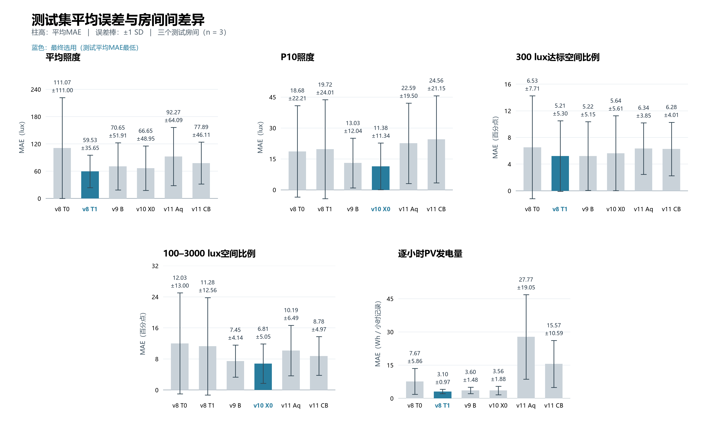

# 性能对比与结果说明

更新：2026-11-09

本研究用房间特征、时间、天气和百叶角度预测采光与PV发电量。本页以三个测试房间的结果为主要比较，开发阶段的交叉验证结果列在后文。v8–v11中的“+”表示已补齐相应输出的实验；原始版本的实验范围见[历史结果](results/history_mae.csv)。

## 数据划分

数据来自10个代表性房间的年度逐时模拟，每个房间有0°、30°、60°、90°四种百叶角度，保留每天07:00–18:00的记录。共175,200条，每个房间17,520条。一条记录对应“一个房间、一个小时、一个角度”。

|数据集|房间|记录数|用途|
|---|---|---:|---|
|开发集|BM223、BM432、BM441、BM522、BM608、LM608、LM703|122,640|训练、调参和交叉验证|
|测试集|BM532、BM702、BMG26|52,560|对固定后的模型评分，不参与训练、预处理拟合或调参|

开发集内部采用两种验证：

- **跨房间验证**：每轮用6个开发房间训练，剩余1个房间验证，共7轮。需要调参时，再在当轮的6个房间内部按房间分组；外层留出的房间只评分。每个房间的全部小时和角度一起划分。
- **跨朝向验证**：每轮留出一个朝向组的全部房间，用其余朝向的房间训练。三个组为posX（BM223）、negY（BM432、BM441、LM608）和posY（BM522、BM608、LM703），对应每轮6间训练／1间验证或4间训练／3间验证。这里的朝向按模型坐标定义。

因此，“6个train＋1个val＋3个test”描述的是跨房间验证的一轮，val会轮换。测试评分所用模型则在开发阶段确定参数后，用全部7个开发房间重新拟合，再预测3个测试房间。数据按房间划分，不随机拆分同一房间的逐时记录。

测试房间虽未参与训练或调参，但成绩已被多次查看，并影响后续研究方向。本页报告的是测试集复评结果。

## 输入与预测目标

基础输入为13个字段。v9及之后增加年度受遮挡入射辐射，用于构造窗地比与辐射相关特征。表中的字段来自已合并的BIM、逐时模拟和EPW数据。

|类别|字段|含义与单位|
|---|---|---|
|房间面积|`Room_Area_m2`|m²|
|玻璃面积|`Glass_Area_m2`|m²|
|房间朝向|`Orientation_X_model`、`Orientation_Y_model`|模型坐标中的朝向分量，无量纲|
|遮挡|`Solar_Obstruction_Ratio`|太阳遮挡比例，无量纲|
|时间|`DOY_1based`、`Hour`|年内第几天（1–365）及小时标签|
|百叶角度|`PVSD_Angle_deg`|0°、30°、60°、90°|
|太阳辐射|`EPW_GHI_Wh_m2`、`EPW_DNI_Wh_m2`、`EPW_DHI_Wh_m2`|逐小时水平总辐射、法向直射辐射、水平散射辐射，Wh/m²|
|太阳位置|`Solar_Altitude_mid_deg`、`Solar_Azimuth_mid_deg`|太阳高度角与方位角，°|
|v9起的额外输入|`Annual_Incident_Shaded_kWh_m2`|年度受遮挡入射辐射，kWh/m²|

`Room_ID`用于关联和划分数据，不作为模型输入。楼层、窗户位置和房间进深不在当前v8–v11的输入中。日期和太阳方位角经sin/cos编码后，基础特征F0为15列；方向交互F1为21列；加入q相关特征的F2为24列；再加入百叶角度交互的B组为30列。这些是特征工程后的列数，样条模型还会在预处理时展开样条基函数。

模型对每个候选角度分别预测以下五项指标：

|输出字段|含义|单位与读法|
|---|---|---|
|`E_mean_lux`|该小时室内采样点的平均照度|lux（勒克斯），1 lux = 1 lm/m²；例如300 lux表示照度水平|
|`E_P10_lux`|该小时空间照度分布的第10百分位数|lux；约10%的采样点照度不高于此值，用于描述较暗区域，非最暗10%点的平均值|
|`F_300_fraction`|该小时照度达到300 lux的空间采样比例|0–1；0.70表示70%的采样点达标|
|`F_UDI_fraction`|该小时照度处于100–3000 lux的空间采样比例|0–1；0.60表示60%的采样点处于此范围，非全年达标时长比例|
|`PV_AC_kWh`|该房间对应PVSD系统在该小时的交流侧发电量|kWh；0.05 kWh = 50 Wh，为一小时内的电能量|

采光比例沿用CSV的空间统计口径，不在本实验中重新计算传感器面积权重。模型预测的是模拟指标，尚无实测建筑数据验证。预测四种角度的性能后，可以另按采光或发电目标选择角度；本页评价数值预测误差，不评价角度推荐成功率。

## 模型方法与配置

模型采用表格数据监督回归。主要算法包括HistGB（直方图梯度提升树）、Random Forest（随机森林）、XGBoost，以及样条＋Ridge。样条先把连续输入展开为非线性基函数，再用带L2正则化的线性回归拟合。

**五项输出分别拟合、分别选参，也可以采用不同算法。** 图表使用“版本＋方案”编号，例如v8 T1、v11 CB；每个编号对应的特征、算法和目标处理见下方对照表。版本表示实验轮次，方案表示这一轮的具体配置。同一套实验配置的五列结果可来自不同回归模型。同为HistGB的F300、FUDI和PV也分别训练，各自有独立的参数与预测函数。

部分输出还包含多个组件：v8相对P10先分别预测平均照度和比例，再计算 `预测P10 = 预测比例 × (配套预测平均照度 + 1 lux)`；推断时不使用真实平均照度。v11的CA、CB则将两个分支恢复到原单位后等权平均。样条＋Ridge可共用矩阵计算，但各输出的系数和损失独立。

各版本是针对不同问题的实验，不是每次都替换前一版全部模型：

|版本|基础模型|主要变化|
|---|---|---|
|v1|Ridge、HistGB|比较8项BIM／时间／角度输入与加入天气后的13项输入，建立基线|
|v2|HistGB|平均照度采用log1p变换；比较P10直接预测、log1p和相对P10处理|
|v3|HistGB、Random Forest、XGBoost|增加算法对照，采用按房间分组的嵌套调参，并评价角度选择|
|v4|HistGB参考、XGBoost|围绕角度选择比较绝对PV和相对参考角度的PV增量预测，选择切换门槛；未更新全部五项输出|
|v5|Random Forest、XGBoost|增加窗地比、窗户数量和平均窗面积等特征；比较相对P10与asinh直接P10|
|v6|Random Forest|复用v5预测，在内层验证中选择相对P10与直接P10的融合权重|
|v7|HistGB、Random Forest、XGBoost|分别优化各输出的损失函数和模型配置，比较平均误差优先与最差房间优先的选择规则|
|v8|树模型、样条＋Ridge|增加太阳方向与房间朝向交互；比较树模型与样条模型，引入跨朝向验证和P10直接预测对照|
|v9|XGBoost，L1损失|增加q相关特征，比较原单位回归与q归一化、样本加权|
|v10|XGBoost，平方误差；样条＋Ridge|在相同F2特征下，比较log1p(y)和log1p(y/q)，分析两个模型家族的泛化差异|
|v11|样条＋Ridge|增加百叶角度交互；调参同时考虑跨房间与跨朝向的平均、最差误差；加入0/q分支等权融合|

`log1p(y)`表示ln(1+y)，训练后逆变换到原单位评分。`q = (玻璃面积 / 房间面积) × (年度受遮挡入射辐射 / 100)`，是现有数据构造的经验尺度。v9–v11的P10补测采用直接回归。地理北旋转、天气来源、小时对齐及百叶角度定义仍未完整核实，方向交互暂按数据特征解释。

### 各版本、各方案的五项输出分别使用什么模型

下表覆盖当前结果表中的全部18个方案。图中展示其中六个：v8 T0、v8 T1、v9 B、v10 X0、v11 Aq、v11 CB。即使五列写着相同算法，每个输出仍分别拟合和选参；“—”表示该方案不预测这一输出。

|版本／方案|特征组|平均照度 E_mean|P10|F300|FUDI|PV|
|---|---|---|---|---|---|---|
|v8 T0|F0|XGBoost · log1p|RF · 相对P10|HistGB · 直接|HistGB · 直接|HistGB · 直接|
|v8 T1|F1|XGBoost · log1p|RF · 相对P10|HistGB · 直接|HistGB · 直接|HistGB · 直接|
|v8 S0|F0|样条Ridge · log1p|样条Ridge · 相对P10|样条Ridge · 直接|样条Ridge · 直接|样条Ridge · 直接|
|v8 S1|F1|样条Ridge · log1p|样条Ridge · 相对P10|样条Ridge · 直接|样条Ridge · 直接|样条Ridge · 直接|
|v8 S1_direct|F1|—|样条Ridge · asinh|—|—|—|
|v9 A|F1|XGBoost-L1 · 原单位|XGBoost-L1 · 原单位|XGBoost-L1 · 原单位|XGBoost-L1 · 原单位|XGBoost-L1 · 原单位|
|v9 B|F2|XGBoost-L1 · 原单位|XGBoost-L1 · 原单位|XGBoost-L1 · 原单位|XGBoost-L1 · 原单位|XGBoost-L1 · 原单位|
|v9 C|F2|XGBoost-L1 · y/q＋加权|XGBoost-L1 · y/q＋加权|XGBoost-L1 · y/q＋加权|XGBoost-L1 · y/q＋加权|XGBoost-L1 · y/q＋加权|
|v10 X0|F2|XGBoost · log1p|XGBoost · log1p|XGBoost · log1p|XGBoost · log1p|XGBoost · log1p|
|v10 Xq|F2|XGBoost · log1p(y/q)|XGBoost · log1p(y/q)|XGBoost · log1p(y/q)|XGBoost · log1p(y/q)|XGBoost · log1p(y/q)|
|v10 S0|F2|样条Ridge · log1p|样条Ridge · log1p|样条Ridge · log1p|样条Ridge · log1p|样条Ridge · log1p|
|v10 Sq|F2|样条Ridge · log1p(y/q)|样条Ridge · log1p(y/q)|样条Ridge · log1p(y/q)|样条Ridge · log1p(y/q)|样条Ridge · log1p(y/q)|
|v11 A0|F2|样条Ridge · log1p|样条Ridge · log1p|样条Ridge · log1p|样条Ridge · log1p|样条Ridge · log1p|
|v11 Aq|F2|样条Ridge · log1p(y/q)|样条Ridge · log1p(y/q)|样条Ridge · log1p(y/q)|样条Ridge · log1p(y/q)|样条Ridge · log1p(y/q)|
|v11 B0|B|样条Ridge · log1p|样条Ridge · log1p|样条Ridge · log1p|样条Ridge · log1p|样条Ridge · log1p|
|v11 Bq|B|样条Ridge · log1p(y/q)|样条Ridge · log1p(y/q)|样条Ridge · log1p(y/q)|样条Ridge · log1p(y/q)|样条Ridge · log1p(y/q)|
|v11 CA|F2|样条Ridge · A0/Aq等权融合|样条Ridge · A0/Aq等权融合|样条Ridge · A0/Aq等权融合|样条Ridge · A0/Aq等权融合|样条Ridge · A0/Aq等权融合|
|v11 CB|B|样条Ridge · B0/Bq等权融合|样条Ridge · B0/Bq等权融合|样条Ridge · B0/Bq等权融合|样条Ridge · B0/Bq等权融合|样条Ridge · B0/Bq等权融合|

RF为Random Forest，HistGB为直方图梯度提升树。“直接”表示按原单位回归；log1p表示拟合ln(1+y)，asinh表示反双曲正弦变换，预测后均还原为原单位。相对P10由两个配套模型组成：一个预测平均照度，另一个预测P10与平均照度加1 lux之比，推断时用两者重建P10。v8 T0/T1的两个组件均为RF，v8 S0/S1的两个组件均为样条Ridge，不使用其他方案的平均照度模型替换。

特征组F0为基础特征（15列），F1增加太阳方向与房间朝向交互（21列），F2增加q及其辐射交互（24列），B组再增加百叶角度交互（30列）。将q作为输入与将目标除以q是两种不同处理；表中明确标注y/q的方案才使用目标归一化。

v9采用XGBoost L1损失，其中C对y/q回归，并按q/训练集均值(q)加权。v10的XGBoost采用平方误差损失。v8树模型沿用固定参数；v8样条、v9和v10在内层按房间分组，以平均MAE选参。v11样条同时考虑内层跨房间、跨朝向的平均与最差MAE；CA/CB将两个分支恢复原单位并约束范围后等权平均。

这张表描述补测后的配置，并非每个原始版本当时都训练了五项输出。原始v8重点比较平均照度、P10和FUDI，原始v9–v11主要研究平均照度；其余输出随后补齐。v1–v7的实验范围见上方历史说明及[历史结果](results/history_mae.csv)，完整实现见[方法说明](METHODS.md)。

## 评价指标

性能指标是模型要预测的五项输出；MAE、RMSE、R²和Bias是衡量这些预测是否准确的评价指标。每项都与相同房间、小时和角度的模拟值比较，变换后的预测先还原到原单位。

|评价指标|计算与含义|判断方式|
|---|---|---|
|MAE|绝对误差的平均值：mean(abs(预测值−模拟值))|越低越好，与输出同单位；为本页主要比较指标|
|RMSE|误差平方均值的平方根|越低越好，对少数较大误差更敏感，与输出同单位|
|R²|1−误差平方和／模拟值相对均值的平方和|越接近1越好；0相当于用该评分房间的模拟均值预测，负值表示更差；无量纲，标签恒定时不计算|
|Bias|mean(预测值−模拟值)|正值表示整体高估，负值表示低估；正负误差会抵消，需结合MAE判断|

例如，平均照度MAE为80 lux，表示预测与模拟值的绝对差平均为80 lux，不代表80%的准确率，也不保证每条误差都小于80 lux。F300的MAE为0.05，即5个百分点：模拟达标比例70%、预测65%，该条记录的误差就是5个百分点。PV的MAE为0.00310 kWh，表示每条小时记录平均相差3.10 Wh；它不是全年累计发电量误差。

下表每格为 **平均MAE / 最差房间MAE**：先在每个房间的全部17,520条记录上计算MAE，再取房间均值和最大值。主结果按3个测试房间等权汇总；附录按7个开发房间等权汇总。最差房间MAE不是最大的单条预测误差。照度单位为lux，F300／FUDI换算为百分点，PV为kWh／小时记录。

粗体标出同一输出、同一评价方式下最低的平均MAE，以未四舍五入的数值比较。五个输出单位不同，不相加计算“总体准确率”。误差是否满足使用要求，还需结合目标阈值、实际数值范围和最差房间表现判断。

## 主要结果：三个测试房间

本表仅使用BM532、BM702和BMG26的52,560条记录。每个候选模型均在7个开发房间上拟合，固定后进行测试评分。跨房间和跨朝向开发成绩见附录，不混入本表。

图中保留六种代表方法，按版本顺序排列。蓝色柱为该输出最终选用的方法，灰色柱为其他对照；选择按完整候选表的测试平均MAE确定，五项最优方法均包含在图中。各编号在不同输出上使用的模型见上方对照表。柱高为BM532、BM702、BMG26三个测试房间MAE的等权平均，误差棒为平均MAE ± 1个样本标准差（SD，n=3，分母为n−1）。标注第一行为平均MAE，第二行为±SD。柱子越低，平均误差越小；误差棒越短，三个房间的MAE越接近。

SD根据三个房间各自的MAE计算，描述房间之间的差异，不是逐小时误差的标准差、置信区间或实际最小—最大范围。部分误差棒下端低于0，是因为SD大于均值，不表示实际MAE为负。只有三个测试房间，SD尚不足以证明模型在其他新房间上的稳定性。

五个子图的纵轴单位和范围不同，应在同一输出内比较方法。F300、FUDI以百分点表示；图中PV换算为Wh，表格仍使用kWh（1 kWh = 1000 Wh）。完整方法的平均MAE与最差房间MAE保留在下表。

|版本|方法|平均照度 lux|P10 lux|F300 百分点|FUDI 百分点|PV kWh/小时记录|
|---|---|---:|---:|---:|---:|---:|
|v8+|[T0](https://github.com/DudyLee/project-2026/blob/d9760cf6b4e8e0fa689bdec6c53b6f6200365a34/scripts/methods.py#L128-L129)|111.07 / 236.97|18.68 / 43.25|6.53 / 15.43|12.03 / 27.04|0.00767 / 0.01434|
|v8+|[T1](https://github.com/DudyLee/project-2026/blob/d9760cf6b4e8e0fa689bdec6c53b6f6200365a34/scripts/methods.py#L128-L129)|**59.53** / 97.39|19.72 / 46.47|**5.21** / 11.32|11.28 / 25.78|**0.00310** / 0.00422|
|v8+|[S0](https://github.com/DudyLee/project-2026/blob/d9760cf6b4e8e0fa689bdec6c53b6f6200365a34/scripts/methods.py#L128-L129)|122.19 / 176.16|19.61 / 31.00|10.28 / 15.15|12.24 / 18.95|0.01211 / 0.01596|
|v8+|[S1](https://github.com/DudyLee/project-2026/blob/d9760cf6b4e8e0fa689bdec6c53b6f6200365a34/scripts/methods.py#L128-L129)|84.04 / 125.88|18.62 / 28.06|8.80 / 11.62|11.47 / 17.19|0.01160 / 0.01603|
|v8+|[S1_direct](https://github.com/DudyLee/project-2026/blob/d9760cf6b4e8e0fa689bdec6c53b6f6200365a34/scripts/methods.py#L128-L129)|—|21.58 / 34.34|—|—|—|
|v9+|[A](https://github.com/DudyLee/project-2026/blob/d9760cf6b4e8e0fa689bdec6c53b6f6200365a34/scripts/methods.py#L130-L130)|71.09 / 147.44|12.71 / 24.36|5.69 / 11.41|7.80 / 12.18|0.00390 / 0.00583|
|v9+|[B](https://github.com/DudyLee/project-2026/blob/d9760cf6b4e8e0fa689bdec6c53b6f6200365a34/scripts/methods.py#L130-L130)|70.65 / 129.44|13.03 / 24.02|5.22 / 11.12|7.45 / 11.99|0.00360 / 0.00530|
|v9+|[C](https://github.com/DudyLee/project-2026/blob/d9760cf6b4e8e0fa689bdec6c53b6f6200365a34/scripts/methods.py#L130-L130)|62.20 / 103.62|13.16 / 24.95|5.67 / 11.37|7.02 / 11.62|0.00539 / 0.00727|
|v10+|[X0](https://github.com/DudyLee/project-2026/blob/d9760cf6b4e8e0fa689bdec6c53b6f6200365a34/scripts/methods.py#L131-L131)|66.65 / 120.52|**11.38** / 22.76|5.64 / 12.09|**6.81** / 12.63|0.00356 / 0.00572|
|v10+|[Xq](https://github.com/DudyLee/project-2026/blob/d9760cf6b4e8e0fa689bdec6c53b6f6200365a34/scripts/methods.py#L131-L131)|65.96 / 100.78|11.79 / 25.12|5.72 / 10.16|8.57 / 13.62|0.00951 / 0.01681|
|v10+|[S0](https://github.com/DudyLee/project-2026/blob/d9760cf6b4e8e0fa689bdec6c53b6f6200365a34/scripts/methods.py#L131-L131)|86.29 / 134.61|24.00 / 42.85|6.46 / 10.89|10.05 / 14.87|0.01119 / 0.01509|
|v10+|[Sq](https://github.com/DudyLee/project-2026/blob/d9760cf6b4e8e0fa689bdec6c53b6f6200365a34/scripts/methods.py#L131-L131)|92.27 / 151.43|24.82 / 48.13|6.06 / 9.23|9.45 / 15.16|0.02290 / 0.04323|
|v11+|[A0](https://github.com/DudyLee/project-2026/blob/d9760cf6b4e8e0fa689bdec6c53b6f6200365a34/scripts/methods.py#L132-L132)|105.18 / 152.59|25.61 / 39.06|6.64 / 10.86|12.08 / 17.78|0.01119 / 0.01509|
|v11+|[Aq](https://github.com/DudyLee/project-2026/blob/d9760cf6b4e8e0fa689bdec6c53b6f6200365a34/scripts/methods.py#L132-L132)|92.27 / 151.43|22.59 / 33.88|6.34 / 10.07|10.19 / 16.11|0.02777 / 0.04750|
|v11+|[B0](https://github.com/DudyLee/project-2026/blob/d9760cf6b4e8e0fa689bdec6c53b6f6200365a34/scripts/methods.py#L132-L132)|76.48 / 108.05|26.02 / 39.58|6.47 / 10.62|9.02 / 13.49|0.01128 / 0.01499|
|v11+|[Bq](https://github.com/DudyLee/project-2026/blob/d9760cf6b4e8e0fa689bdec6c53b6f6200365a34/scripts/methods.py#L132-L132)|102.23 / 144.64|23.19 / 34.89|6.29 / 10.14|10.20 / 17.18|0.02805 / 0.04608|
|v11+|[CA](https://github.com/DudyLee/project-2026/blob/d9760cf6b4e8e0fa689bdec6c53b6f6200365a34/scripts/methods.py#L257-L259)|83.09 / 113.30|24.07 / 36.39|6.35 / 10.37|9.52 / 14.48|0.01530 / 0.02427|
|v11+|[CB](https://github.com/DudyLee/project-2026/blob/d9760cf6b4e8e0fa689bdec6c53b6f6200365a34/scripts/methods.py#L257-L259)|77.89 / 111.33|24.56 / 37.16|6.28 / 10.31|8.78 / 13.75|0.01557 / 0.02401|

## 最终方法选择：以测试平均MAE为准

每个输出分别从v8–v11补测的全部适用候选中，选择三个测试房间等权平均MAE最低的方法，使用未四舍五入的数值比较。SD、最差房间MAE和开发验证结果用于说明表现，不再作为本次选择的额外筛选条件。这一规则替代此前兼顾开发稳定性的推荐。

|输出|选定方法|模型与处理|测试平均MAE|测试最差房间MAE|
|---|---|---|---:|---:|
|平均照度（lux）|[v8 T1](https://github.com/DudyLee/project-2026/blob/d9760cf6b4e8e0fa689bdec6c53b6f6200365a34/scripts/methods.py#L128-L129)|方向交互 · XGBoost-log1p|59.53|97.39|
|P10（lux）|[v10 X0](https://github.com/DudyLee/project-2026/blob/d9760cf6b4e8e0fa689bdec6c53b6f6200365a34/scripts/methods.py#L131-L131)|q特征 · XGBoost-log1p直接预测|11.38|22.76|
|F300（百分点）|[v8 T1](https://github.com/DudyLee/project-2026/blob/d9760cf6b4e8e0fa689bdec6c53b6f6200365a34/scripts/methods.py#L128-L129)|方向交互 · HistGB直接回归|5.21|11.32|
|FUDI（百分点）|[v10 X0](https://github.com/DudyLee/project-2026/blob/d9760cf6b4e8e0fa689bdec6c53b6f6200365a34/scripts/methods.py#L131-L131)|q特征 · XGBoost-log1p|6.81|12.63|
|PV（kWh/小时记录）|[v8 T1](https://github.com/DudyLee/project-2026/blob/d9760cf6b4e8e0fa689bdec6c53b6f6200365a34/scripts/methods.py#L128-L129)|方向交互 · HistGB直接回归|0.00310|0.00422|

### 选定方法的具体做法

五个输出对应五个独立回归器。其中三个为XGBoost，两个为HistGB。同样的算法也分别拟合，不共享输出模型。当前选择中的P10为直接回归，不再依赖RF平均照度模型或其他输出的预测值。

|输出|输入与特征|训练目标与算法|预测还原与范围约束|
|---|---|---|---|
|平均照度|F1：基础输入及太阳方向与房间朝向交互，共21列|XGBoost拟合log1p(E_mean)，平方误差损失；固定最大深度3|expm1还原为lux，负值截为0|
|P10|F2：F1加q、q×DHI和q×DNI×cos(太阳高度角)，共24列|独立XGBoost拟合log1p(P10)，平方误差损失；开发集内层选定最大深度3|expm1还原为lux，负值截为0；不使用平均照度预测|
|F300|F1，共21列|独立HistGB按原始fraction目标直接回归，平方误差损失|限制在[0,1]；展示MAE时乘100换算为百分点|
|FUDI|F2，共24列|独立XGBoost拟合log1p(FUDI)，平方误差损失；开发集内层选定最大深度5|expm1还原为fraction，再限制在[0,1]|
|PV|F1，共21列|独立HistGB按原始kWh目标直接回归，平方误差损失|负值截为0；绘图时将kWh误差乘1000换算为Wh|

F2中的q是输入特征；本次选定的v10 X0不对目标除以q。三个XGBoost模型均使用150棵树、学习率0.07；P10和FUDI的深度在7个开发房间内部按房间分组验证，从3和5中选择。两个HistGB沿用固定配置：150轮提升、学习率0.07、每棵树最多15个叶节点。训练后的模型均使用全部7个开发房间拟合，三个测试房间未参与拟合或超参数搜索。完整树参数见[配置文件](configs/tree_parameters.json)，训练与还原逻辑见[方法代码](scripts/methods.py)。

这次调整确定了最终使用的方法组合，并未重新训练、打包或替换试用版模型。表中数值来自已有候选模型的测试预测。由于最终方法是在查看测试结果后选出的，这些成绩属于用于选模的测试集表现，不能再作为该组合的独立泛化验证。开发验证结果保留在附录，用于呈现与测试排名不同的情况。

## 附录：开发阶段的交叉验证

以下为7个开发房间上的交叉验证成绩，用于比较方法和诊断跨房间、跨朝向的稳定性。每次验证房间均不参与该轮训练或调参，但开发集已用于多轮方案改进。

### 跨房间验证：每轮6间训练、1间验证，共7轮

|版本|方法|平均照度 lux|P10 lux|F300 百分点|FUDI 百分点|PV kWh/小时记录|
|---|---|---:|---:|---:|---:|---:|
|v8+|[T0](https://github.com/DudyLee/project-2026/blob/d9760cf6b4e8e0fa689bdec6c53b6f6200365a34/scripts/methods.py#L128-L129)|82.43 / 231.64|**9.40** / 29.28|7.12 / 15.69|11.04 / 25.47|0.01261 / 0.02381|
|v8+|[T1](https://github.com/DudyLee/project-2026/blob/d9760cf6b4e8e0fa689bdec6c53b6f6200365a34/scripts/methods.py#L128-L129)|70.27 / 223.46|9.61 / 33.92|6.21 / 13.26|11.35 / 29.03|**0.00896** / 0.01839|
|v8+|[S0](https://github.com/DudyLee/project-2026/blob/d9760cf6b4e8e0fa689bdec6c53b6f6200365a34/scripts/methods.py#L128-L129)|76.13 / 252.29|11.81 / 41.73|7.43 / 15.05|9.87 / 22.09|0.01869 / 0.03735|
|v8+|[S1](https://github.com/DudyLee/project-2026/blob/d9760cf6b4e8e0fa689bdec6c53b6f6200365a34/scripts/methods.py#L128-L129)|64.38 / 222.83|14.05 / 43.98|7.36 / 14.62|9.51 / 22.37|0.01759 / 0.03377|
|v8+|[S1_direct](https://github.com/DudyLee/project-2026/blob/d9760cf6b4e8e0fa689bdec6c53b6f6200365a34/scripts/methods.py#L128-L129)|—|12.34 / 53.44|—|—|—|
|v9+|[A](https://github.com/DudyLee/project-2026/blob/d9760cf6b4e8e0fa689bdec6c53b6f6200365a34/scripts/methods.py#L130-L130)|84.66 / 230.83|15.85 / 46.15|7.26 / 14.51|9.77 / 20.78|0.01332 / 0.03209|
|v9+|[B](https://github.com/DudyLee/project-2026/blob/d9760cf6b4e8e0fa689bdec6c53b6f6200365a34/scripts/methods.py#L130-L130)|83.04 / 234.72|15.63 / 44.06|5.88 / 10.78|7.95 / 16.59|0.01394 / 0.03163|
|v9+|[C](https://github.com/DudyLee/project-2026/blob/d9760cf6b4e8e0fa689bdec6c53b6f6200365a34/scripts/methods.py#L130-L130)|64.94 / 171.20|13.01 / 48.42|5.83 / 11.94|13.67 / 26.44|0.02030 / 0.04592|
|v10+|[X0](https://github.com/DudyLee/project-2026/blob/d9760cf6b4e8e0fa689bdec6c53b6f6200365a34/scripts/methods.py#L131-L131)|70.46 / 219.99|13.99 / 40.37|6.14 / 11.16|**7.80** / 15.24|0.01481 / 0.03574|
|v10+|[Xq](https://github.com/DudyLee/project-2026/blob/d9760cf6b4e8e0fa689bdec6c53b6f6200365a34/scripts/methods.py#L131-L131)|55.01 / 137.00|18.35 / 69.90|5.32 / 8.64|13.50 / 23.88|0.02090 / 0.04528|
|v10+|[S0](https://github.com/DudyLee/project-2026/blob/d9760cf6b4e8e0fa689bdec6c53b6f6200365a34/scripts/methods.py#L131-L131)|**48.04** / 112.54|13.86 / 57.88|5.75 / 10.12|9.91 / 23.18|0.02007 / 0.03199|
|v10+|[Sq](https://github.com/DudyLee/project-2026/blob/d9760cf6b4e8e0fa689bdec6c53b6f6200365a34/scripts/methods.py#L131-L131)|61.04 / 178.63|14.21 / 58.49|5.46 / 10.52|8.32 / 16.49|0.02164 / 0.04347|
|v11+|[A0](https://github.com/DudyLee/project-2026/blob/d9760cf6b4e8e0fa689bdec6c53b6f6200365a34/scripts/methods.py#L132-L132)|66.59 / 194.74|14.90 / 57.88|6.09 / 13.84|11.57 / 28.48|0.02128 / 0.03733|
|v11+|[Aq](https://github.com/DudyLee/project-2026/blob/d9760cf6b4e8e0fa689bdec6c53b6f6200365a34/scripts/methods.py#L132-L132)|59.95 / 178.63|13.53 / 51.64|**5.20** / 8.63|9.25 / 21.87|0.02223 / 0.04347|
|v11+|[B0](https://github.com/DudyLee/project-2026/blob/d9760cf6b4e8e0fa689bdec6c53b6f6200365a34/scripts/methods.py#L132-L132)|50.93 / 124.31|14.79 / 57.57|6.00 / 11.17|9.64 / 22.83|0.02172 / 0.03697|
|v11+|[Bq](https://github.com/DudyLee/project-2026/blob/d9760cf6b4e8e0fa689bdec6c53b6f6200365a34/scripts/methods.py#L132-L132)|61.72 / 185.53|14.89 / 51.10|5.33 / 9.75|9.31 / 21.93|0.02218 / 0.04064|
|v11+|[CA](https://github.com/DudyLee/project-2026/blob/d9760cf6b4e8e0fa689bdec6c53b6f6200365a34/scripts/methods.py#L257-L259)|61.49 / 184.57|12.05 / 54.75|5.53 / 10.97|9.50 / 25.15|0.01880 / 0.02882|
|v11+|[CB](https://github.com/DudyLee/project-2026/blob/d9760cf6b4e8e0fa689bdec6c53b6f6200365a34/scripts/methods.py#L257-L259)|53.28 / 147.74|13.50 / 54.33|5.50 / 9.56|8.84 / 22.12|0.01866 / 0.03152|

### 跨朝向验证：每轮留出一个朝向组，共3轮

同一朝向组的全部房间一起留出。以下汇总仍按7个房间等权计算，并非三个朝向组等权。

|版本|方法|平均照度 lux|P10 lux|F300 百分点|FUDI 百分点|PV kWh/小时记录|
|---|---|---:|---:|---:|---:|---:|
|v8+|[T0](https://github.com/DudyLee/project-2026/blob/d9760cf6b4e8e0fa689bdec6c53b6f6200365a34/scripts/methods.py#L128-L129)|110.61 / 252.25|9.45 / 29.31|7.37 / 15.72|11.23 / 24.95|0.01542 / 0.02498|
|v8+|[T1](https://github.com/DudyLee/project-2026/blob/d9760cf6b4e8e0fa689bdec6c53b6f6200365a34/scripts/methods.py#L128-L129)|84.03 / 224.67|**9.08** / 30.22|7.12 / 17.73|11.49 / 28.71|**0.01099** / 0.02277|
|v8+|[S0](https://github.com/DudyLee/project-2026/blob/d9760cf6b4e8e0fa689bdec6c53b6f6200365a34/scripts/methods.py#L128-L129)|110.95 / 230.25|10.88 / 43.35|7.58 / 14.25|10.97 / 20.98|0.02272 / 0.03873|
|v8+|[S1](https://github.com/DudyLee/project-2026/blob/d9760cf6b4e8e0fa689bdec6c53b6f6200365a34/scripts/methods.py#L128-L129)|91.49 / 198.62|10.73 / 43.76|7.14 / 13.80|10.76 / 21.00|0.02167 / 0.03820|
|v8+|[S1_direct](https://github.com/DudyLee/project-2026/blob/d9760cf6b4e8e0fa689bdec6c53b6f6200365a34/scripts/methods.py#L128-L129)|—|12.77 / 55.92|—|—|—|
|v9+|[A](https://github.com/DudyLee/project-2026/blob/d9760cf6b4e8e0fa689bdec6c53b6f6200365a34/scripts/methods.py#L130-L130)|90.54 / 232.97|14.74 / 46.15|6.43 / 12.75|9.58 / 20.78|0.01355 / 0.02860|
|v9+|[B](https://github.com/DudyLee/project-2026/blob/d9760cf6b4e8e0fa689bdec6c53b6f6200365a34/scripts/methods.py#L130-L130)|82.58 / 239.45|17.19 / 44.06|5.50 / 9.80|**9.41** / 17.06|0.01445 / 0.03103|
|v9+|[C](https://github.com/DudyLee/project-2026/blob/d9760cf6b4e8e0fa689bdec6c53b6f6200365a34/scripts/methods.py#L130-L130)|83.37 / 247.45|23.99 / 96.95|6.70 / 12.05|15.19 / 31.49|0.02251 / 0.05318|
|v10+|[X0](https://github.com/DudyLee/project-2026/blob/d9760cf6b4e8e0fa689bdec6c53b6f6200365a34/scripts/methods.py#L131-L131)|75.07 / 225.78|14.74 / 40.37|6.25 / 11.29|10.19 / 16.15|0.01591 / 0.03702|
|v10+|[Xq](https://github.com/DudyLee/project-2026/blob/d9760cf6b4e8e0fa689bdec6c53b6f6200365a34/scripts/methods.py#L131-L131)|78.63 / 210.32|21.94 / 92.69|6.82 / 11.48|15.23 / 28.10|0.02319 / 0.05681|
|v10+|[S0](https://github.com/DudyLee/project-2026/blob/d9760cf6b4e8e0fa689bdec6c53b6f6200365a34/scripts/methods.py#L131-L131)|115.46 / 480.14|51.07 / 289.72|5.51 / 8.07|13.02 / 26.25|0.01979 / 0.03367|
|v10+|[Sq](https://github.com/DudyLee/project-2026/blob/d9760cf6b4e8e0fa689bdec6c53b6f6200365a34/scripts/methods.py#L131-L131)|68.02 / 209.20|63.75 / 378.98|5.95 / 10.77|11.11 / 21.87|0.02388 / 0.04637|
|v11+|[A0](https://github.com/DudyLee/project-2026/blob/d9760cf6b4e8e0fa689bdec6c53b6f6200365a34/scripts/methods.py#L132-L132)|70.50 / 198.25|15.14 / 64.09|5.82 / 10.39|13.04 / 25.29|0.01913 / 0.03662|
|v11+|[Aq](https://github.com/DudyLee/project-2026/blob/d9760cf6b4e8e0fa689bdec6c53b6f6200365a34/scripts/methods.py#L132-L132)|69.22 / 206.36|19.54 / 67.20|5.58 / 8.84|12.66 / 25.15|0.02361 / 0.04637|
|v11+|[B0](https://github.com/DudyLee/project-2026/blob/d9760cf6b4e8e0fa689bdec6c53b6f6200365a34/scripts/methods.py#L132-L132)|70.73 / 204.97|17.45 / 63.80|5.84 / 10.32|11.51 / 25.18|0.01919 / 0.03575|
|v11+|[Bq](https://github.com/DudyLee/project-2026/blob/d9760cf6b4e8e0fa689bdec6c53b6f6200365a34/scripts/methods.py#L132-L132)|69.40 / 205.97|22.64 / 89.76|5.57 / 8.65|12.75 / 25.13|0.02458 / 0.05632|
|v11+|[CA](https://github.com/DudyLee/project-2026/blob/d9760cf6b4e8e0fa689bdec6c53b6f6200365a34/scripts/methods.py#L257-L259)|**66.59** / 193.83|16.99 / 64.94|5.45 / 8.18|12.56 / 23.35|0.01767 / 0.03892|
|v11+|[CB](https://github.com/DudyLee/project-2026/blob/d9760cf6b4e8e0fa689bdec6c53b6f6200365a34/scripts/methods.py#L257-L259)|66.87 / 194.43|19.78 / 69.62|**5.45** / 7.97|11.60 / 25.10|0.01753 / 0.04139|

## 数据文件与代码

|文件|范围|单位|
|---|---|---|
|[summary_metrics.csv](results/summary_metrics.csv)|258项版本/方法/目标/验证汇总，含最差房间|MAE为原始单位；比例为fraction|
|[room_metrics.csv](results/room_metrics.csv)|1,462条逐房间误差，可重算汇总|同上|
|[history_mae.csv](results/history_mae.csv)|v1–v11原版、试用版及补充实验历史总表|照度lux；F300/FUDI为百分点；PV为kWh|

`archived_experiment_*`是沿用开发结果，`supplement_new_fit`是新增开发结果，`supplement_all7_frozen`是本次全7拟合后的测试结果。历史表的空白表示当时未测；S1_direct是P10专项，其他输出不适用。历史表中不同验证方式不可混作一次测试。

方法名跳转到固定提交中的定义分支；CA/CB直接跳到融合函数。同版本方法通过公共函数和配置实现，因此部分链接会定位同一分支。进一步查看：[特征](https://github.com/DudyLee/project-2026/blob/d9760cf6b4e8e0fa689bdec6c53b6f6200365a34/scripts/methods.py#L73-L94) · [目标变换与还原](https://github.com/DudyLee/project-2026/blob/d9760cf6b4e8e0fa689bdec6c53b6f6200365a34/scripts/methods.py#L134-L164) · [内层划分](https://github.com/DudyLee/project-2026/blob/d9760cf6b4e8e0fa689bdec6c53b6f6200365a34/scripts/methods.py#L166-L174) · [选参与训练](https://github.com/DudyLee/project-2026/blob/d9760cf6b4e8e0fa689bdec6c53b6f6200365a34/scripts/methods.py#L192-L236) · [v8各输出树参数](https://github.com/DudyLee/project-2026/blob/d9760cf6b4e8e0fa689bdec6c53b6f6200365a34/configs/tree_parameters.json)。

## 结果核对与局限

原实验已核对模型与源文件哈希、参数选择、测试前的模型固定记录及保存模型的预测结果，并从新增预测重新计算了1,098条房间指标。v11 B0/CB的原平均照度结果在数值精度内复现。仓库中的检查程序用于核对汇总表和逐房间表；从逐小时预测重新计算指标需要本地原始资料。

实验仅覆盖7个开发房间和3个测试房间，测试结果也已用于后续分析。这些成绩说明了模型在现有房间上的表现，对其他房间的适用性仍需进一步验证。
